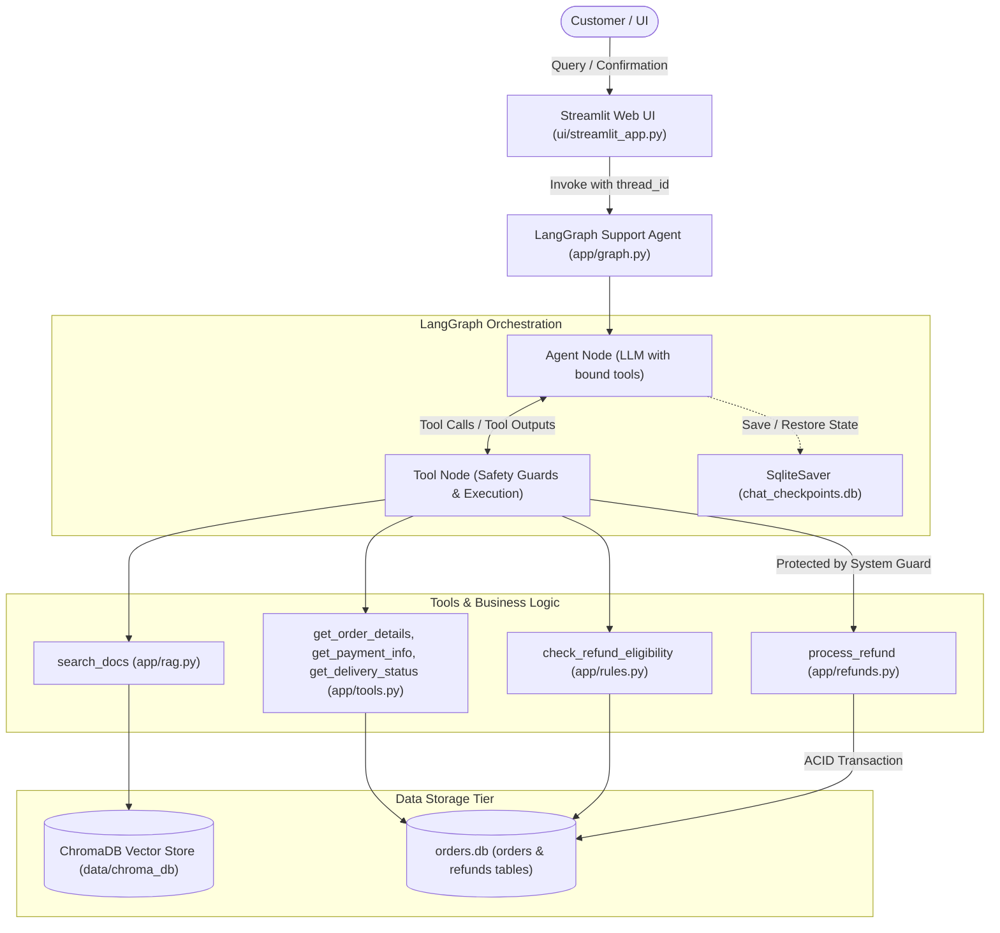
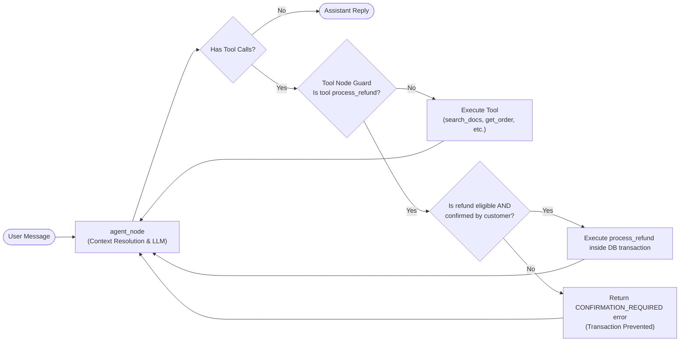

# Architecture & Technical Design

## 1. System Overview

The AI Customer Support Agent is a resilient, production-ready system combining:
1. **LangGraph State Orchestration** for autonomous agent control flow and state management.
2. **LangChain Tools** providing structured interfaces to SQLite and ChromaDB.
3. **Thresholded RAG** over product and store documentation with strict citation guarantees.
4. **Deterministic Business Rules in Python** to govern financial refund decisions independently of LLM prompts.
5. **ACID Transaction Execution** for order refunds with rollback on failure.
6. **Thread-Level Memory Persistence** via SQLite checkpointer (`SqliteSaver`).

---

## 2. Component Diagram

---

## 3. LangGraph Control Flow & Confirmation Guard

### Refund Confirmation Guard Details
The guard in `tool_node` provides deterministic defense-in-depth:
1. When `process_refund` is invoked by the model, the node verifies two conditions:
   - `check_refund_eligibility` was executed and reported `eligible=True` for this specific `order_id`.
   - The user has explicitly submitted an affirmative confirmation in conversation (e.g. *"yes"*, *"confirm"*, *"proceed"*).
2. If either condition fails, the execution is **physically intercepted** and blocked with `CONFIRMATION_REQUIRED`, instructing the model to check eligibility and request customer confirmation first.

---

## 4. Database Model

The database is SQLite (`orders.db`) with foreign key enforcement enabled (`PRAGMA foreign_keys = ON;`).

### `orders` Table
| Column | Type | Constraints | Description |
|---|---|---|---|
| `order_id` | TEXT | PRIMARY KEY | Unique order identifier (e.g., `ORD1001`) |
| `customer_name` | TEXT | NOT NULL | Customer name associated with order |
| `product_name` | TEXT | NOT NULL | Item purchased |
| `order_date` | DATE | NOT NULL | Date order was placed (`YYYY-MM-DD`) |
| `order_price` | REAL | NOT NULL | Total purchase price in ₹ |
| `payment_method` | TEXT | NOT NULL | UPI, Credit Card, Debit Card, Net Banking |
| `payment_status` | TEXT | NOT NULL | Successful, Partially Refunded, Refunded |
| `delivery_status` | TEXT | NOT NULL | Delivered, In Transit, Shipped, Cancelled |
| `order_status` | TEXT | NOT NULL | Delivered, Shipped, Cancelled, Processing |
| `refunded_amount` | REAL | NOT NULL DEFAULT 0.0 | Cumulative total amount refunded |

### `refunds` Table
| Column | Type | Constraints | Description |
|---|---|---|---|
| `refund_id` | TEXT | PRIMARY KEY | Unique refund transaction ID (`REF-XXXXXXXX`) |
| `order_id` | TEXT | FOREIGN KEY -> orders(order_id) | Target order ID |
| `amount` | REAL | NOT NULL | Amount refunded in this transaction |
| `reason` | TEXT | NOT NULL | Justification for refund |
| `created_at` | TIMESTAMP | DEFAULT CURRENT_TIMESTAMP | Audit timestamp |

---

## 5. Key Design Decisions

1. **Business Rules in Code (NOT in Prompts)**
   - Financial constraints are strictly evaluated in `app/rules.py` in pure Python.
   - Prompts can be hallucinated or manipulated by prompt injections; pure Python code cannot.
   - The model only receives the evaluated boolean result, remaining balance, and reason string.

2. **ACID Transactional Refunds**
   - In `app/refunds.py`, refund execution occurs inside an atomic SQLite transaction (`BEGIN IMMEDIATE`).
   - The order row is read and re-validated inside the active transaction.
   - The `refunds` row is inserted and `orders.refunded_amount`, `payment_status`, and `order_status` are updated atomically.
   - If any step fails, `conn.rollback()` restores the exact previous state.

3. **Cumulative Partial Refund Tracking**
   - Orders can undergo multiple partial refunds as long as `sum(refunds) <= order_price`.
   - The remaining refundable balance is continuously calculated as `order_price - refunded_amount`.

4. **Thresholded RAG with Automated Citations**
   - The documentation chunker preserves section titles in metadata.
   - Chunks are embedded with `all-MiniLM-L6-v2` into ChromaDB.
   - Similarity scores are computed from cosine distance. Queries with best scores below `RAG_SIMILARITY_THRESHOLD` (0.45) return `found=False` and politely propose human escalation rather than fabricating policies.

5. **Thread-Level Conversational Memory**
   - Persistent LangGraph checkpointing (`SqliteSaver`) stores state by `thread_id`.
   - Enables multi-turn contextual resolution without asking the user to repeat their Order ID.

---

## 6. Limitations & Future Improvements

1. **Authentication**:
   - Currently, identity scoping is simulated by selecting customer context in the UI. In production, this would bind to an authenticated session token (e.g. JWT or OAuth2).
2. **Payment Gateway Integration**:
   - The current system records real internal database transactions. Integration with external gateways (Stripe, Razorpay) would hook into the transaction lifecycle.
3. **Multi-Item Line Item Breakdowns**:
   - The existing schema represents single-product orders. Expanding to an `order_items` table would allow individual line-item returns.
